<!-- FUTURISTIC CYBERPUNK HEADER BANNER -->

  <picture>
    <source media="(prefers-color-scheme: dark)" srcset="./banner-dark.svg" />
    <source media="(prefers-color-scheme: light)" srcset="./banner-light.svg" />
    
  </picture>

<!-- DYNAMIC TYPING SVG & GREETING -->
<h1 align="center">Hi there! I'm indoctrinatedrecluse 👋</h1>

  <picture>
    <source media="(prefers-color-scheme: dark)" srcset="./profile-3d-contrib/typing-dark.svg" />
    <source media="(prefers-color-scheme: light)" srcset="./profile-3d-contrib/typing-light.svg" />
    
  </picture>

  <picture>
    <source media="(prefers-color-scheme: dark)" srcset="https://visitor-badge.laobi.icu/badge?page_id=indoctrinatedrecluse.profile&amp;left_text=PROFILE%20VIEWS&amp;left_color=%231a1b26&amp;right_color=%23bf5af2&amp;logo=github&amp;radius=0" />
    <source media="(prefers-color-scheme: light)" srcset="https://visitor-badge.laobi.icu/badge?page_id=indoctrinatedrecluse.profile&amp;left_text=PROFILE%20VIEWS&amp;left_color=%23ecebf7&amp;right_color=%237c3aed&amp;logo=github&amp;radius=0" />
    
  </picture>

<!-- SECTION DIVIDER -->

  <picture>
    <source media="(prefers-color-scheme: dark)" srcset="./profile-3d-contrib/glowing-line-dark.svg" />
    <source media="(prefers-color-scheme: light)" srcset="./profile-3d-contrib/glowing-line-light.svg" />
    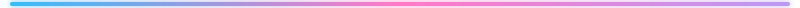
  </picture>

<!-- ABOUT ME SECTION -->
<h2 align="center">🌌 System Log: About Me</h2>

  🤖 <b>Developer</b> &nbsp;|&nbsp; 💻 <b>Problem Solver</b> &nbsp;|&nbsp; 🌌 <b>Tech Explorer</b>

  <i>A curious mind decoding complex systems, building elegant solutions, and exploring the frontiers of software.</i>

<!-- SECTION DIVIDER -->

  <picture>
    <source media="(prefers-color-scheme: dark)" srcset="./profile-3d-contrib/glowing-line-dark.svg" />
    <source media="(prefers-color-scheme: light)" srcset="./profile-3d-contrib/glowing-line-light.svg" />
    
  </picture>

<!-- SYSTEM STATUS -->
<h2 align="center">🖥️ System Status</h2>

  <picture>
    <source media="(prefers-color-scheme: dark)" srcset="./profile-3d-contrib/system-status-dark.svg" />
    <source media="(prefers-color-scheme: light)" srcset="./profile-3d-contrib/system-status-light.svg" />
    
  </picture>

<!-- SECTION DIVIDER -->

  <picture>
    <source media="(prefers-color-scheme: dark)" srcset="./profile-3d-contrib/glowing-line-dark.svg" />
    <source media="(prefers-color-scheme: light)" srcset="./profile-3d-contrib/glowing-line-light.svg" />
    
  </picture>

<!-- GITHUB STATS DASHBOARD GRID -->
<h2 align="center">📊 GitHub Stats Dashboard</h2>

  <picture>
    <source media="(prefers-color-scheme: dark)" srcset="./profile-3d-contrib/stats-dark.svg" />
    <source media="(prefers-color-scheme: light)" srcset="./profile-3d-contrib/stats-light.svg" />
    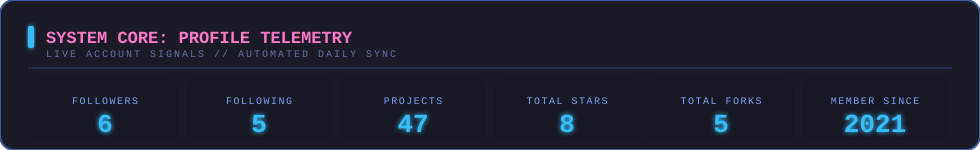
  </picture>

  <a href="https://github.com/indoctrinatedrecluse">
    <picture>
      <source media="(prefers-color-scheme: dark)" srcset="https://streak-stats.demolab.com/?user=indoctrinatedrecluse&amp;theme=tokyonight" />
      <source media="(prefers-color-scheme: light)" srcset="https://streak-stats.demolab.com/?user=indoctrinatedrecluse&amp;theme=clean-light" />
      
    </picture>
  </a>
  <a href="https://github.com/indoctrinatedrecluse/indoctrinatedrecluse/actions">
    <picture>
      <source media="(prefers-color-scheme: dark)" srcset="https://img.shields.io/github/actions/workflow/status/indoctrinatedrecluse/indoctrinatedrecluse/profile-3d.yml?style=flat-square&amp;label=DASHBOARD%20SYNC&amp;labelColor=1a1b26&amp;color=bb9af3&amp;logo=githubactions&amp;logoColor=ffffff" />
      <source media="(prefers-color-scheme: light)" srcset="https://img.shields.io/github/actions/workflow/status/indoctrinatedrecluse/indoctrinatedrecluse/profile-3d.yml?style=flat-square&amp;label=DASHBOARD%20SYNC&amp;labelColor=ecebf7&amp;color=7c3aed&amp;logo=githubactions&amp;logoColor=1e2335" />
      
    </picture>
  </a>

  <picture>
    <source media="(prefers-color-scheme: dark)" srcset="https://img.shields.io/github/followers/indoctrinatedrecluse?style=flat-square&amp;label=FOLLOWERS&amp;labelColor=1a1b26&amp;color=38bdf8&amp;logo=github&amp;logoColor=ffffff" />
    <source media="(prefers-color-scheme: light)" srcset="https://img.shields.io/github/followers/indoctrinatedrecluse?style=flat-square&amp;label=FOLLOWERS&amp;labelColor=ecebf7&amp;color=0277bd&amp;logo=github&amp;logoColor=1e2335" />
    
  </picture>
  <picture>
    <source media="(prefers-color-scheme: dark)" srcset="https://img.shields.io/github/stars/indoctrinatedrecluse/indoctrinatedrecluse?style=flat-square&amp;label=THIS%20REPO%20STARS&amp;labelColor=1a1b26&amp;color=7aa2f7&amp;logo=github&amp;logoColor=ffffff" />
    <source media="(prefers-color-scheme: light)" srcset="https://img.shields.io/github/stars/indoctrinatedrecluse/indoctrinatedrecluse?style=flat-square&amp;label=THIS%20REPO%20STARS&amp;labelColor=ecebf7&amp;color=5865b0&amp;logo=github&amp;logoColor=1e2335" />
    
  </picture>
  <picture>
    <source media="(prefers-color-scheme: dark)" srcset="https://img.shields.io/github/last-commit/indoctrinatedrecluse/indoctrinatedrecluse?style=flat-square&amp;label=LAST%20COMMIT&amp;labelColor=1a1b26&amp;color=bb9af3&amp;logo=git&amp;logoColor=ffffff" />
    <source media="(prefers-color-scheme: light)" srcset="https://img.shields.io/github/last-commit/indoctrinatedrecluse/indoctrinatedrecluse?style=flat-square&amp;label=LAST%20COMMIT&amp;labelColor=ecebf7&amp;color=7c3aed&amp;logo=git&amp;logoColor=1e2335" />
    
  </picture>

<!-- SECTION DIVIDER -->

  <picture>
    <source media="(prefers-color-scheme: dark)" srcset="./profile-3d-contrib/glowing-line-dark.svg" />
    <source media="(prefers-color-scheme: light)" srcset="./profile-3d-contrib/glowing-line-light.svg" />
    
  </picture>

<!-- SNAKE CONTRIBUTION GAME -->
<h2 align="center">🐍 Snake Contribution Matrix</h2>

  <picture>
    <source media="(prefers-color-scheme: dark)" srcset="./profile-3d-contrib/github-contribution-grid-snake-dark.svg" />
    <source media="(prefers-color-scheme: light)" srcset="./profile-3d-contrib/github-contribution-grid-snake.svg" />
    
  </picture>

<!-- SECTION DIVIDER -->

  <picture>
    <source media="(prefers-color-scheme: dark)" srcset="./profile-3d-contrib/glowing-line-dark.svg" />
    <source media="(prefers-color-scheme: light)" srcset="./profile-3d-contrib/glowing-line-light.svg" />
    
  </picture>

<!-- 3D CONTRIBUTION CALENDAR -->
<h2 align="center">🌌 3D Contribution Calendar</h2>

  <picture>
    <source media="(prefers-color-scheme: dark)" srcset="./profile-3d-contrib/profile-night-rainbow-dark.svg" />
    <source media="(prefers-color-scheme: light)" srcset="./profile-3d-contrib/profile-night-rainbow-light.svg" />
    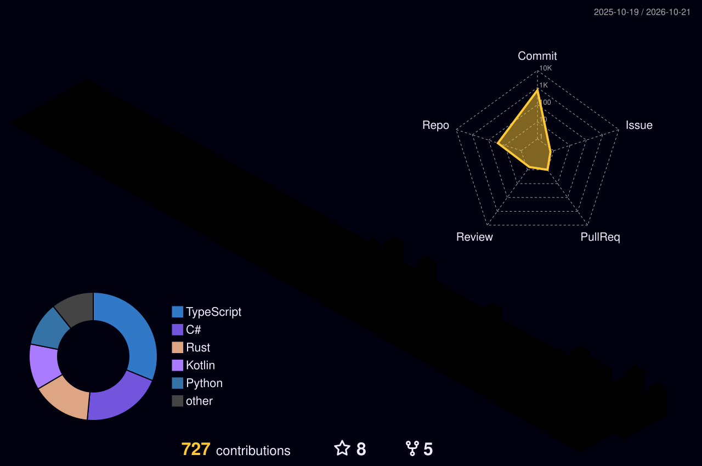
  </picture>

  Contribution render — adaptive day/night theme sync.

<!-- SECTION DIVIDER -->

  <picture>
    <source media="(prefers-color-scheme: dark)" srcset="./profile-3d-contrib/glowing-line-dark.svg" />
    <source media="(prefers-color-scheme: light)" srcset="./profile-3d-contrib/glowing-line-light.svg" />
    
  </picture>

<!-- COMMIT GRID HEATMAP -->
<h2 align="center">🔥 Commit Grid: Rolling 365-Day Heatmap</h2>

  <picture>
    <source media="(prefers-color-scheme: dark)" srcset="./profile-3d-contrib/isocalendar-dark.svg" />
    <source media="(prefers-color-scheme: light)" srcset="./profile-3d-contrib/isocalendar-light.svg" />
    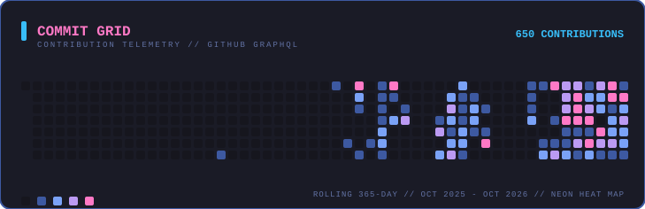
  </picture>

  Adaptive neon heatmap — synced with live GitHub GraphQL contributions.

<!-- SECTION DIVIDER -->

  <picture>
    <source media="(prefers-color-scheme: dark)" srcset="./profile-3d-contrib/glowing-line-dark.svg" />
    <source media="(prefers-color-scheme: light)" srcset="./profile-3d-contrib/glowing-line-light.svg" />
    
  </picture>

<!-- CUSTOM LANGUAGE MATRIX -->
<h2 align="center">💻 System Core: Language Matrix</h2>

  <picture>
    <source media="(prefers-color-scheme: dark)" srcset="./profile-3d-contrib/languages-dark.svg" />
    <source media="(prefers-color-scheme: light)" srcset="./profile-3d-contrib/languages-light.svg" />
    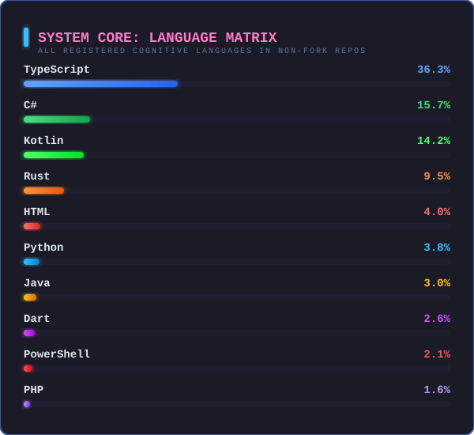
  </picture>

<!-- SECTION DIVIDER -->

  <picture>
    <source media="(prefers-color-scheme: dark)" srcset="./profile-3d-contrib/glowing-line-dark.svg" />
    <source media="(prefers-color-scheme: light)" srcset="./profile-3d-contrib/glowing-line-light.svg" />
    
  </picture>

<!-- SYSTEM ACHIEVEMENTS -->
<h2 align="center">🏆 System Achievements</h2>

  <picture>
    <source media="(prefers-color-scheme: dark)" srcset="./profile-3d-contrib/achievements-dark.svg" />
    <source media="(prefers-color-scheme: light)" srcset="./profile-3d-contrib/achievements-light.svg" />
    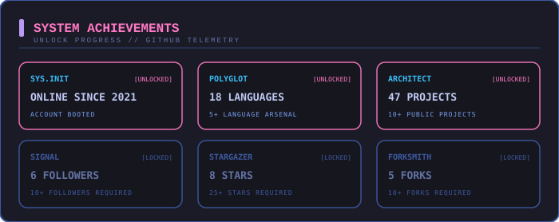
  </picture>

  Interactive protocol badges — click any tile to view associated signals.

<!-- SECTION DIVIDER -->

  <picture>
    <source media="(prefers-color-scheme: dark)" srcset="./profile-3d-contrib/glowing-line-dark.svg" />
    <source media="(prefers-color-scheme: light)" srcset="./profile-3d-contrib/glowing-line-light.svg" />
    
  </picture>

<!-- PINNED REPOSITORIES -->
<h2 align="center">📌 Pinned Repositories</h2>

  <picture>
    <source media="(prefers-color-scheme: dark)" srcset="./profile-3d-contrib/pinned-dark.svg" />
    <source media="(prefers-color-scheme: light)" srcset="./profile-3d-contrib/pinned-light.svg" />
    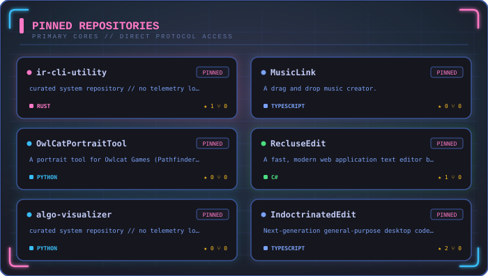
  </picture>

  Interactive protocol access — click any repository card to open on GitHub.

<!-- SECTION DIVIDER -->

  <picture>
    <source media="(prefers-color-scheme: dark)" srcset="./profile-3d-contrib/glowing-line-dark.svg" />
    <source media="(prefers-color-scheme: light)" srcset="./profile-3d-contrib/glowing-line-light.svg" />
    
  </picture>

<!-- FEATURED PROJECTS -->
<h2 align="center">📦 Featured Projects</h2>

  <picture>
    <source media="(prefers-color-scheme: dark)" srcset="./profile-3d-contrib/featured-dark.svg" />
    <source media="(prefers-color-scheme: light)" srcset="./profile-3d-contrib/featured-light.svg" />
    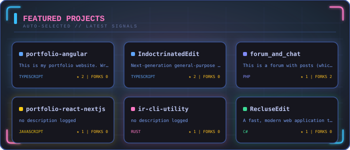
  </picture>

  Interactive repository telemetry — click any card to visit the repository.

<!-- SECTION DIVIDER -->

  <picture>
    <source media="(prefers-color-scheme: dark)" srcset="./profile-3d-contrib/glowing-line-dark.svg" />
    <source media="(prefers-color-scheme: light)" srcset="./profile-3d-contrib/glowing-line-light.svg" />
    
  </picture>

<!-- RECENT ACTIVITY -->
<h2 align="center">📡 Recent Activity Feed</h2>

  <picture>
    <source media="(prefers-color-scheme: dark)" srcset="./profile-3d-contrib/activity-dark.svg" />
    <source media="(prefers-color-scheme: light)" srcset="./profile-3d-contrib/activity-light.svg" />
    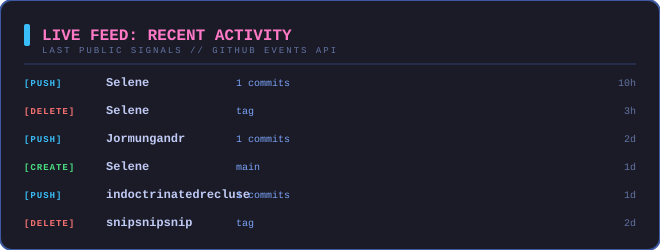
  </picture>

  Live from the GitHub events stream — click any event to jump to the repository.

<!-- SECTION DIVIDER -->

  <picture>
    <source media="(prefers-color-scheme: dark)" srcset="./profile-3d-contrib/glowing-line-dark.svg" />
    <source media="(prefers-color-scheme: light)" srcset="./profile-3d-contrib/glowing-line-light.svg" />
    
  </picture>

<!-- SKILLS & TECHNOLOGIES -->
<h2 align="center">🛠️ Tech Stack & Toolkit</h2>

<h3 align="center">Languages</h3>

  
  
  
  
  
  

<h3 align="center">Frameworks & Technologies</h3>

  
  
  
  

<h3 align="center">Infrastructure & Tools</h3>

  
  
  
  

<!-- SECTION DIVIDER -->

  <picture>
    <source media="(prefers-color-scheme: dark)" srcset="./profile-3d-contrib/glowing-line-dark.svg" />
    <source media="(prefers-color-scheme: light)" srcset="./profile-3d-contrib/glowing-line-light.svg" />
    
  </picture>

<!-- CONNECT WITH ME -->
<h2 align="center">🤝 Connect with Me</h2>

  
  
  

<!-- SECTION DIVIDER -->

  <picture>
    <source media="(prefers-color-scheme: dark)" srcset="./profile-3d-contrib/glowing-line-dark.svg" />
    <source media="(prefers-color-scheme: light)" srcset="./profile-3d-contrib/glowing-line-light.svg" />
    
  </picture>

<!-- FOOTER -->

  Designed with 💜 by indoctrinatedrecluse

